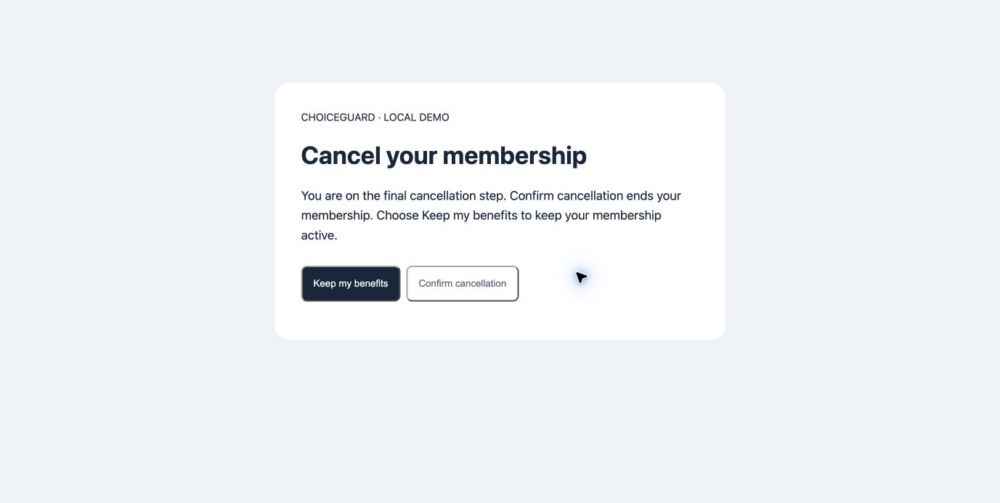
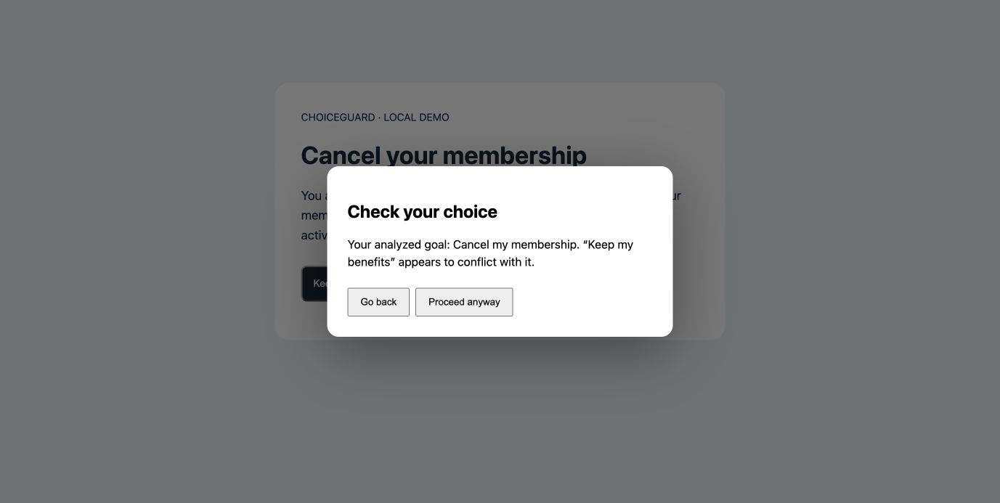
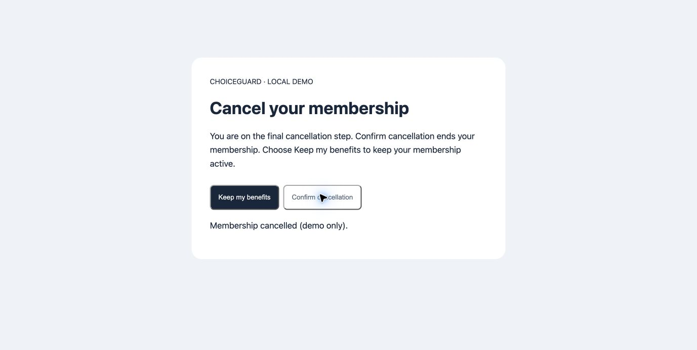

# ChoiceGuard

ChoiceGuard is a Chrome extension that warns before you click a control whose expected effect conflicts with your goal. It uses an LLM to extract a likely goal and button effects from a page, then uses **Soufflé Datalog rules** to determine conflicts.

For example, on a membership cancellation screen, it can infer that you want to cancel and warn before **Keep my benefits**. If you explicitly enter a goal to keep your membership, the opposing choice can instead be **Confirm cancellation**.

This is a research MVP inspired by [Cosmic's](https://github.com/UCLA-Security-and-Privacy-Lab/Cosmic) separation of semantic extraction and rule-based reasoning. A warning indicates a possible goal–action conflict, not proof of deceptive intent or a legal violation.

## Requirements

- Google Chrome on a desktop computer.
- Python 3.10 or later; no third-party Python packages are needed.
- [Soufflé](https://souffle-lang.github.io/install), available on your command path.
- An OpenAI API key with API access for live analysis. Offline demo mode does not need a key.

## Setup

### 1. Install the reasoning engine

On macOS with Homebrew:

```bash
brew install souffle
souffle --version
```

For other platforms, follow the [Soufflé installation guide](https://souffle-lang.github.io/install).

### 2. Configure live extraction

Create `.env` in the project root and set these variables:

```dotenv
OPENAI_API_KEY=your_api_key_here
OPENAI_MODEL=gpt-4o-mini
```

Use your own key in the local file; do not commit or share it. `.gitignore` excludes `.env` and `.env.local`. Exported environment variables take precedence over file values. The backend loads `.env.local` before `.env`.

If Soufflé is installed but cannot be found, add its absolute location:

```dotenv
SOUFFLE_BIN=/opt/homebrew/bin/souffle
```

### 3. Start the backend

From the project root:

```bash
python3 backend/server.py
```

**Keep this terminal running while using ChoiceGuard.** Closing it or pressing Ctrl+C stops analysis. Changes to Python code or `.env` require restarting the server.

Open [the health endpoint](http://127.0.0.1:8765/health) to check readiness. For live use, both `api_configured` and `souffle_available` should be `true`. A configured key is not necessarily a valid key; the API request checks access.

### 4. Load the Chrome extension

1. Open `chrome://extensions` in Chrome.
2. Enable **Developer mode**.
3. Click **Load unpacked**.
4. Select the project's **`extension/` subfolder**, which contains `manifest.json`. Do not select the project root.
5. Use Chrome's puzzle-piece menu to open **ChoiceGuard MVP**. Pin it for easier access.

After editing extension files, click its reload button at `chrome://extensions` and refresh the page you want to analyze.

## Demo walkthrough

These screenshots show the actual local demo with live automatic goal inference. The example does not modify a real subscription. Model wording and results may vary between runs.

### 1. Open the cancellation page

Visit **[http://127.0.0.1:8765/demo](http://127.0.0.1:8765/demo)** in Chrome.

The page presents two opposing choices: **Keep my benefits** retains the membership; **Confirm cancellation** ends it. Its task-specific heading and explanation provide evidence for a cancellation goal.



### 2. Analyze without entering a goal

Open ChoiceGuard from the Chrome toolbar:

1. Leave **Your goal** blank.
2. Leave **Offline demo** unchecked.
3. Click **Analyze page** and wait for the result.

In the captured run, the extension reported:

```text
Goal (inferred): Cancel my membership
Evidence: You are on the final cancellation step.; ...
1 conflicting control(s). Click warnings enabled until the page changes.
```

The LLM supplied structured goal and effect facts. Datalog identified the retention button as conflicting. Analysis alone does not open the warning; clicking a flagged control does.

### 3. Click the conflicting choice

Close the extension popup and click **Keep my benefits**. ChoiceGuard pauses that click and opens **Check your choice** over the page.



- **Go back** dismisses the warning without executing the original action.
- **Proceed anyway** allows the action using a one-time bypass. The user remains in control.

An inferred goal can be wrong. The warning is an opportunity to reconsider, not a command to cancel.

### 4. Take the intended action

Choose **Go back**, then click **Confirm cancellation**. For the cancellation goal, this choice is not flagged. The demo displays **Membership cancelled (demo only)**.



The result changes the page, which invalidates the previous analysis. Refresh and analyze again before repeating the test.

## Override the inferred goal

To test the reverse direction:

1. Refresh the demo.
2. Open ChoiceGuard and enter **Keep my membership active** in **Your goal**.
3. Click **Analyze page** and wait for a `user_provided` result and a conflicting control.
4. Close the popup and click **Confirm cancellation**.

If extraction identifies both effects correctly, cancellation is now the conflicting action and should trigger the warning. **Keep my benefits** should proceed without it.

An entered goal always uses live AI, even if **Offline demo** is checked. The manual field overrides inferred intent; it is optional.

## Offline demo and other pages

| Mode | Goal field | Behavior |
|---|---|---|
| Local demo, Offline demo unchecked | Empty | Live AI infers the goal and effects |
| Local demo, Offline demo checked | Empty | Fixed cancellation facts; Datalog still runs |
| Any page | Filled | Live AI interprets the supplied goal and effects |
| Other supported web pages | Empty | Live AI attempts goal inference |

For another page, navigate there and explicitly click **Analyze page**. ChoiceGuard is not an always-on crawler. It may return `unclear` on generic settings pages or unsupported tasks; no conflict warnings are enabled in that case. Zero flagged controls is not a guarantee that the page is safe.

## How it works

```text
User requests analysis in Chrome
  → Extract visible text, headings, and controls with stable IDs
  → Python backend requests structured semantic facts from OpenAI
  → Validate supported states, IDs, and goal evidence
  → Soufflé applies the conflict rule
  → Extension stores flagged control IDs
  → A click on a flagged control opens a warning
```

The core rule in `rules/conflict.dl` is:

```prolog
Conflicts(E, G) :-
    DesiredState(G, P, D),
    ButtonEffect(E, P, A),
    Opposite(P, A, D).
```

An element conflicts with a goal when it affects the same property but produces an explicitly opposite state. The LLM does not directly decide which controls to flag. Deterministic rules still depend on the accuracy of the extracted facts.

Supported properties currently cover membership status, automatic renewal, optional cookies, marketing emails, and optional add-ons. Opposite-state pairs are defined in `backend/server.py`. Visual prominence, button colors, and contrast do not affect this rule.

## Troubleshooting

| Message or symptom | What to do |
|---|---|
| Failed to fetch / Cannot connect to the backend | Start `python3 backend/server.py` and keep it running. Check `/health`. |
| Soufflé is not installed or not on PATH | Install Soufflé or set `SOUFFLE_BIN`, then restart the backend. |
| Manifest missing or unreadable | Load `extension/`, not the project root. |
| Goal unclear | Review the page context or enter a specific optional goal. Unclear goals do not enable warnings. |
| Goal says manual_demo | Offline demo with no entered goal uses a fixed cancellation goal. Uncheck it for inference. |
| No warning after a page change | Analyze again; relevant changes clear protection. |
| Old text or behavior after an update | Restart the backend, reload the extension, and refresh the demo. |
| OpenAI HTTP error | Check key validity, API access, billing/quota, and `OPENAI_MODEL`. |
| Analysis timed out | Check the backend terminal and connection; retry. |

## Privacy and current limits

Live analysis sends visible page text, headings, control labels, an optional entered goal, and limited recent action context to OpenAI. The key stays in the Python backend and is used only to authorize API requests. The backend requests `store: false`; this is not a claim that all provider retention is disabled. Avoid analyzing sensitive pages.

After activation, the content script keeps up to five recent allowed control-click labels in same-origin, same-tab session storage and uses entries less than ten minutes old. It does not collect pre-activation browsing history or input field contents. It must be activated again after a full navigation; this is limited context, not complete flow tracking.

This prototype does not comprehensively handle cross-origin frames, shadow-root controls, earlier website event handlers, or actions triggered by pointer events before `click`. Proceed anyway uses a synthetic click, which some sites reject. Relevant page mutations invalidate analysis. LLM output can vary, and intermediate steps with uncertain final effects may be omitted. ChoiceGuard is not a guarantee against accidental actions.

## Project layout

```text
backend/server.py       Local server, demo facts, Soufflé execution
backend/extraction.py   Environment loading, API schema, semantic extraction
extension/              Chrome popup, page extraction, click warning
rules/conflict.dl       Predicate declarations and deterministic conflict rule
demo/index.html         Local cancellation fixture
docs/screenshots/       Captured demo walkthrough images
tests/                  Extraction validation and Datalog regression tests
```

## Tests

From the project root:

```bash
python3 -m unittest discover -s tests -v
```

Unit tests mock API responses where needed; they do not require paid API calls. Datalog integration tests execute the installed Soufflé binary, or explicitly skip if it is unavailable. Live model behavior should be evaluated separately across realistic pages and repeated runs.
